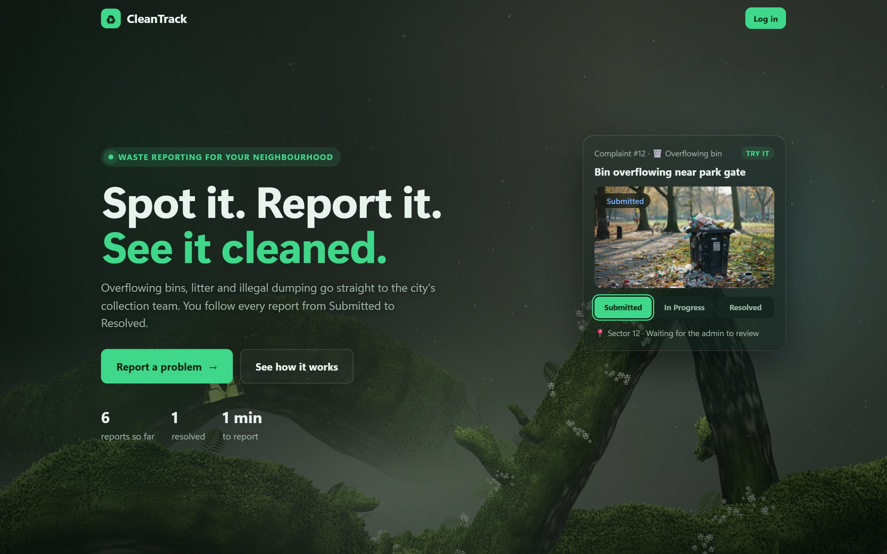
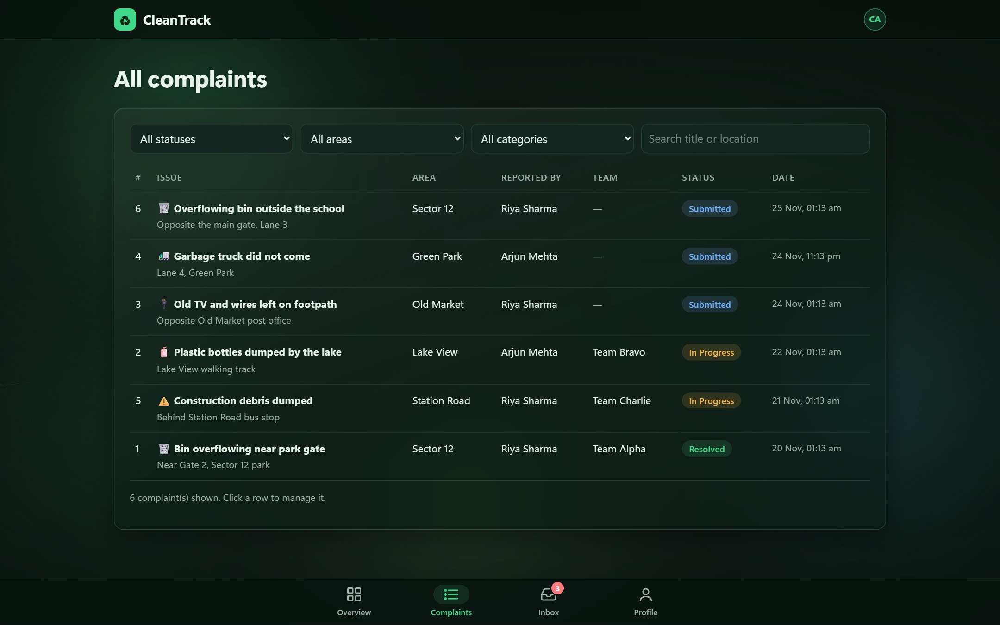

# ♻ CleanTrack: report and track waste problems

**CodesClash 2026 · Preliminary Round · Problem Statement 01: Waste Management System**

**Live site:** https://cleantrack-6qha.onrender.com (free hosting: the first visit can take about a minute to wake it up)

Residents report waste problems (overflowing bins, litter, plastic, e-waste, dumping) with a category, area, location and an optional photo.
An admin (the city's collection team) sees every report, filters them, assigns a team and updates the status.
Residents follow each report from **Submitted → In Progress → Resolved**, with a full history.





## Features

| Feature | Where |
|---|---|
| Report an issue (title, category, area, location, description) | Resident dashboard |
| "Other" choice to type your own category or area (saved on that report only) | Resident dashboard |
| Optional Google Maps link (only real Google Maps links are accepted) | Resident dashboard, opened from the complaint pop-up |
| Optional photo upload (PNG/JPG/WEBP, max 2 MB) | Resident dashboard |
| Track my reports with a progress bar and history timeline | Resident dashboard |
| Create a resident account | Login page |
| See all complaints, filter by status/area/category, search | Admin dashboard |
| Change status, assign a collection team, add a note | Admin dashboard (click a row) |
| Summary counts (total, submitted, in progress, resolved) | Home + Admin |
| Area-wise summary (which area has the most open problems) | Home + Admin |
| Waste segregation awareness tips | Home page |
| Works on phones (responsive layout) | All pages |

## Run it on your computer

You need **Node.js 22.23.5 or newer** (we used v26). There is nothing to install with npm: the project has no packages.

```powershell
cd path\to\cleantrack
node server.js
```

Open **http://localhost:3000** in your browser. Stop the server with `Ctrl + C`.

- `npm start` does the same as `node server.js`.
- `npm test` runs the security tests on a throwaway copy (your data is not touched).
- `npm run reset` deletes the database. The next start creates it again with fresh sample data. (Stop the server first.)

### Demo accounts (sample data)

| Role | Email | Password |
|---|---|---|
| Resident | riya@cleantrack.test | resident123 |
| Resident | arjun@cleantrack.test | resident123 |

These are fake demo accounts made only for this prototype. The login page has buttons that fill them in for you.

### Owner and admin (no public password)

| Role | ID | What it can do |
|---|---|---|
| Owner | owner@cleantrack.test | Everything an admin can, plus: see all accounts, make or remove admins, suspend accounts |
| Admin | admin@cleantrack.test | See, filter, update and assign all reports |

Both are locked until you set their passwords with `npm run set-passwords` (typed hidden, only a hash is stored).
`npm run reset` locks them again.

## Tech stack

- **Frontend:** HTML, CSS, plain JavaScript (no framework); a 3D forest backdrop from ThreeUI (three.js / WebGL) on the home page
- **Backend:** Node.js built-in `http` module (a small REST API in `server.js`)
- **Database:** SQLite through Node's built-in `node:sqlite` module (`db.js`), stored in `data/cleantrack.db`
- **Security** (`security.js`): scrypt password hashing, parameterised SQL (`?` placeholders), HTML escaping plus a strict Content-Security-Policy, security headers, HttpOnly session cookies that expire, rate limits, checks against requests from other websites, server-side role checks on pages, API and photos, photos checked by their content, and only listed files can be opened. `npm test` attacks a throwaway copy to check all of this
- **My work (Ayush Bose):** research, choosing the problem and the features, the design direction, trying every version and giving feedback.
- **AI assistance:** Claude (Anthropic) was used as a coding assistant, for the code, security tests, animation, documents and the first draft of the slides.

## Settings (environment variables, all optional)

| Name | What it does |
|---|---|
| `PORT` | Port number (default 3000) |
| `OWNER_PASSWORD` | Sets the owner password on a hosting site (at least 12 characters) |
| `ADMIN_PASSWORD` | Sets the admin password on a hosting site (at least 12 characters, different from the owner's) |
| `CLIENT_IP_HEADER` | Name of the header with the visitor's real address, only when a hosting company sets it |

## Project structure

```
cleantrack/
├── server.js          ← web server + API routes
├── security.js        ← protections: headers, rate limits, sessions, cleaning input
├── db.js              ← database tables, password hashing, sample data
├── package.json       ← project info and npm scripts
├── scripts/reset.js   ← deletes the database (npm run reset)
├── public/            ← everything the browser downloads
│   ├── index.html     ← home page (stats, area summary, tips)
│   ├── login.html     ← log in / create account
│   ├── resident.html  ← resident dashboard
│   ├── admin.html     ← admin dashboard
│   ├── css/style.css
│   └── js/ common.js, home.js, login.js, resident.js, admin.js
├── docs/              ← screenshots, diagrams, guides
└── data/              ← database + uploaded photos (created on first run, NOT on GitHub)
```

## API (for the curious)

| Method | URL | Who | What it does |
|---|---|---|---|
| GET | /api/me | anyone | who is logged in |
| GET | /api/meta | anyone | areas, categories, teams, statuses |
| GET | /api/stats | anyone | counts by status, area, category |
| POST | /api/register | anyone | create a resident account |
| POST | /api/login, /api/logout | anyone | log in / out |
| GET | /api/complaints | logged in | resident: own reports · admin: all (with filters) |
| POST | /api/complaints | resident | submit a new report |
| GET | /api/complaints/:id | its resident or an admin | one report + history |
| PATCH | /api/complaints/:id | admin | change status / team / note |
| GET, PATCH | /api/users, /api/users/:id | site owner | see accounts, change role, suspend |

## What is simulated or not built (honest list)

- **All data is sample (mock) data:** areas, teams, users and the first 5 complaints are made up.
- **Notifications are simulated:** when an admin updates a complaint, the server only *prints* "[SIMULATED NOTIFICATION]" in the terminal. No SMS or email is sent.
- **No map view inside the site:** location is a text landmark plus an area, and optionally a Google Maps link that opens in a new tab. No Google API is used. Instead of a map we show an area-wise summary table.
- **Sessions are kept in server memory:** restarting the server logs everyone out.
- **The live site resets:** it runs on Render's free plan, which does not keep files. When it sleeps, restarts or updates, new reports, photos and accounts are lost and the sample data comes back.
- **The bin photo** is a sample picture found through Google Images (original owner not identified), used only for the demo.

## Future improvements

Map view with GPS pin (OpenStreetMap + Leaflet), real SMS/email/WhatsApp alerts, a login for collection team members on their phones, before/after photos when resolving, duplicate-report detection, ratings after a complaint is resolved, Hindi and other languages, and storing sessions in the database.

## Credits (open-source parts)

- **3D forest behind the home page hero:** the "SylvaHero" template from [ThreeUI Community](https://threeui.com)
  (npm package `@designcodeio/threeui` 1.2.0, MIT licence, © 2026 Meng To). We copied its page into `public/forest/`,
  hid all of its own text, cards and menu, removed its button effect script, and added a pause switch. It uses
  [three.js](https://threejs.org) (MIT). Licence: `public/forest/THREEUI-LICENSE.txt`.
- **"How it works" video:** an animated example drawn in code for this project (`scripts/story-film/film.html`) and turned
  into `public/video/story.mp4` with ffmpeg. No stock footage.
- Everything else (pages, styles, server, database) was written for this project.

## License

MIT
